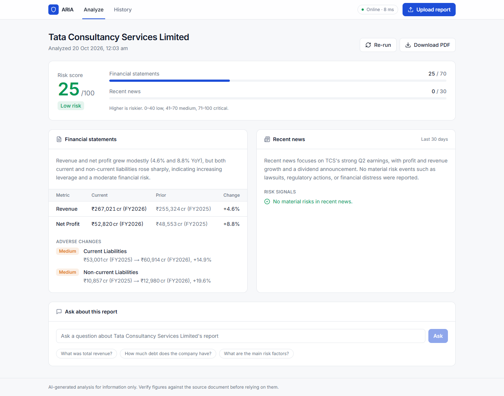
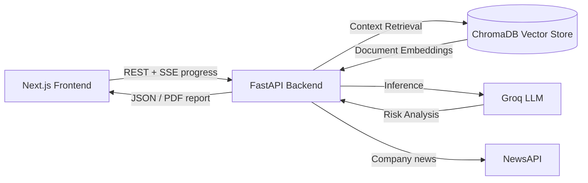

# ARIA: Professional Risk Audit Infrastructure

A full-stack system for financial risk intelligence. It cross-references a company's own financial documents with live market news to surface financial and reputational risks.

[](https://github.com/sarvesh-raam/ARIA/actions)
[](https://aria-intelligence.vercel.app)
[](https://opensource.org/licenses/MIT)

---

## Executive Summary
ARIA (Autonomous Risk Intelligence Agent) audits financial reports such as annual reports and filings. Upload a PDF and ARIA extracts the key financial metrics with Retrieval-Augmented Generation (RAG), flags anomalies like sharp revenue drops or debt spikes, checks the last 30 days of news for the company, and combines both into a single 0-100 risk score with a downloadable PDF report.

If the LLM or the news service fails, ARIA reports the failure instead of returning a guessed score.

## Interface Preview


## Deployment
- **Frontend**: Deployed on Vercel [View Live Dashboard](https://aria-intelligence.vercel.app)
- **Backend**: Docker container hosted on Hugging Face Spaces (synced from `backend/` on every push to `main`)

## Architecture Diagram

```text
Frontend (Next.js)
        ↓
FastAPI Backend ──→ NewsAPI (live news)
        ↓
ChromaDB (Vector DB)
        ↓
LLM (Groq)
```

<details>
<summary>View detailed dependency graph</summary>


</details>

## System Architecture & Components
- **Frontend**: Next.js 15 dashboard (light and dark themes) with live progress via Server-Sent Events (SSE), a score breakdown, key metrics, news signals with sources, Q&A on the uploaded report, and a history of past analyses.
- **Backend API**: Python FastAPI layer handling uploads, orchestration, validation and rate limiting.
- **RAG Pipeline**: PyMuPDF text extraction, overlapping chunks, and ChromaDB with `all-MiniLM-L6-v2` sentence-transformer embeddings.
- **LLM**: Groq-hosted `openai/gpt-oss-120b` by default (configurable), using JSON mode for structured output that is validated before use.
- **News**: NewsAPI search on the company name over the last 30 days, scored for risk by the LLM.
- **Reports**: PDF risk reports generated with fpdf2 from the same analysis shown on the dashboard.

## API Flow
1. **Upload (`POST /api/upload`)**: The PDF is validated (type, size, readable, not password-protected), chunked, embedded into ChromaDB, and the company name is identified. Re-uploading a known document repairs anything that failed the first time.
2. **Progress (`GET /api/progress/{id}`)**: An SSE stream reports each step while uploads and analyses run.
3. **Analysis (`GET /api/analyze/{doc_id}`)**: The backend locates the income statement, balance sheet and cash flow statement plus other relevant passages, and the LLM extracts key metrics and adverse changes (financial score 0-50). Any figure the LLM quotes that isn't in the document is discarded. Recent news is scored for material risks relative to the company's size (news score 0-50). The overall score weights the document 70% and news 30%.
4. **Report (`GET /api/report/{doc_id}`)**: Downloads a PDF built from the saved analysis.
5. **Q&A (`POST /api/query`)**: Ask any question about an uploaded document.

| Score | Rating |
|---|---|
| 0-40 | Low Risk [STABLE] |
| 41-70 | Medium Risk [ELEVATED] |
| 71-100 | Critical Risk [CRITICAL] |

**Private workspaces:** every request carries an `X-Workspace-Id` header, a random ID each browser generates for itself (no sign-up). Documents are stored per workspace, so visitors only see and query their own uploads; other workspaces get a 404.

Other endpoints: `GET /api/analysis/{doc_id}` (last saved analysis, no LLM call), `GET /api/documents` (list; filenames and previews only with the admin key) and `DELETE /api/documents/{doc_id}` (admin key required).

## Example Output Payload
`GET /api/analyze/{doc_id}`:
```json
{
  "doc_id": "ae57ef9020fa",
  "company": "NVIDIA Corporation",
  "overall_risk_score": 34,
  "rating": "Low Risk [STABLE]",
  "score_breakdown": { "financial": 14, "financial_max": 70, "news": 20, "news_max": 30 },
  "financial_signals": {
    "financial_risk_score": 10,
    "key_metrics": [
      { "metric": "Revenue", "current": "$130,497M (FY2025)", "prior": "$60,922M (FY2024)", "change": "+114%" }
    ],
    "anomalies": [
      {
        "metric": "Gross Margin",
        "observation": "Declined from 75% to 69% YoY, modest but notable given strong revenue growth.",
        "severity": "low"
      }
    ],
    "summary": "Revenue surged while debt stayed flat; only modest gross-margin compression."
  },
  "news_signals": {
    "news_risk_score": 33,
    "summary": "Recent news highlights a large stock buyback alongside emerging legal and political exposure.",
    "signals": [
      {
        "signal": "Vesting discrepancy lawsuit",
        "impact": "medium",
        "description": "A claim over a stock option grant suggests potential litigation."
      }
    ],
    "top_stories": [
      { "title": "Nvidia unveils record $150 billion stock buyback plan", "url": "https://...", "source": "Yahoo" }
    ],
    "available": true,
    "window_days": 30
  },
  "timestamp": "2026-10-19T22:52:08.112345"
}
```

Errors return a JSON `detail` message: `400` for invalid files, `413` for files over the size limit, `429` when rate limited, and `502` when the LLM fails.

## Environment & Deployment

### Requirements
- Python 3.9+
- Node.js 20 (LTS)
- API keys: [Groq](https://console.groq.com) (required), [NewsAPI](https://newsapi.org) (optional; without it news is shown as unavailable)

### Configuration
Copy `backend/.env.example` to `backend/.env` and `frontend/.env.example` to `frontend/.env`.

| Variable | Where | Default | Purpose |
|---|---|---|---|
| `GROQ_API_KEY` | backend | (required) | Groq API key |
| `NEWS_API_KEY` | backend | (none) | NewsAPI key for live news |
| `GROQ_MODEL` | backend | `openai/gpt-oss-120b` | Groq model to use |
| `GROQ_FALLBACK_MODEL` | backend | `openai/gpt-oss-20b` | Backup model used when the main model hits its rate limit (empty disables) |
| `GROQ_REASONING_EFFORT` | backend | `low` | Reasoning effort for gpt-oss models |
| `MAX_UPLOAD_MB` | backend | `25` | Maximum PDF size |
| `ADMIN_API_KEY` | backend | (none) | Enables delete and full document details via the `X-Admin-Key` header. Server-side only, never put it in the frontend |
| `RATE_LIMIT_PER_MINUTE` | backend | `10` | AI requests per IP per minute (`0` disables) |
| `NEXT_PUBLIC_API_URL` | frontend | `http://localhost:8000` | Backend URL |

### Running Locally
**A. Backend (FastAPI)**
```bash
cd backend
python -m venv venv
source venv/bin/activate        # Windows: venv\Scripts\activate
pip install -r requirements.txt
python main.py
```

**B. Frontend (Next.js)**
```bash
cd frontend
npm install
npm run dev
```

### Testing
```bash
cd backend
pip install pytest
pytest tests/test_api.py
```
The tests need no API keys. CI runs them along with frontend lint and build on every push.

## Technical Roadmap
- Multi-Agent Orchestration: Graph-based reasoning loops to increase detection accuracy.
- SEC/EDGAR Integration: Direct ingestion of filings via ticker-based lookup.
- Persistent storage for the hosted backend (Hugging Face Spaces storage resets on restart).

## License
Distributed under the MIT License.
